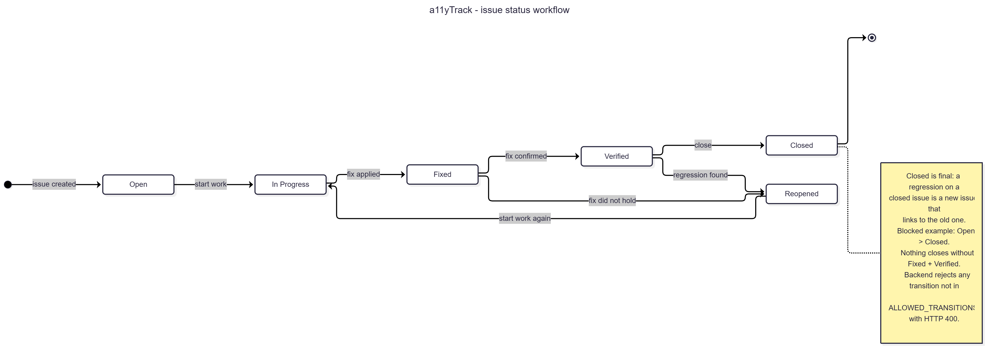

# ARCHITECTURE.md

Part 1 of the Unified Accessibility take-home: the production design for a11yTrack,
sized for 500 teams (about 20,000 users), up to 1 million issues, and bursts of
hundreds of new issues in a minute when an audit finishes. Part 2 is the smaller
local build in this repository. The two are kept consistent on purpose: the local
app is the production app with the edge, identity, queue and object-storage tiers
left out, not a different design.

Diagrams were drawn in Mermaid, edited and exported with the Mermaid Live Editor.
Sources are in `docs/*.mmd` next to the PNGs so they can be changed on the call.
In every diagram, **solid boxes and arrows are built locally in Part 2** (and also
exist in production) and **dashed boxes and arrows are production-only**.

## 1. Architecture diagram

**Browser.** Server-rendered HTML forms, keyboard and screen-reader driven. No
client-side router, so page titles, focus and announcements come from the server
(section 8).

**Edge (production only).** A load balancer terminating TLS in front of N app
replicas, and a CDN for `style.css`. Locally Flask serves `/static` itself. Added
because 20,000 users need more than one process and because TLS belongs at the edge.

**Identity (production only).** An external identity provider (SSO / OIDC). The app
verifies the ID token once and then sets the same signed session cookie the local
build uses, so every route behind `login_required` is identical in both. Locally,
sign-in is a picker of two seeded users, as the brief requires.

**Application tier.** The Flask + Jinja2 app in `app/`. It owns all the rules:
`validate_issue()` in `validation.py`, `ALLOWED_TRANSITIONS` in `workflow.py`,
`owner_id` scoping and the `version` check in `routes.py`. Sessions are signed
cookies, so replicas are stateless and need no shared session store.

**Primary database.** PostgreSQL in production, SQLite locally, through the same
SQLAlchemy models (`models.py`). Tables `users`, `issues`, `status_changes` exist in
both; `teams` and `attachments` are production-only (section 3).

**Async (production only).** A Redis-backed job queue and one worker, used only for
the critical-issue email (section 7). The request never waits on SMTP.

**Object storage (production only).** S3-style storage for screenshot attachments,
written and read by the browser through pre-signed URLs so bytes never pass through
the app replicas.

Deliberately absent: a read replica (read-after-write staleness on the
create-then-list flow) and a page cache (per-user, per-filter pages have a low hit
rate). Both are discussed in section 6.

## 2. Request flows

Both flows below are the code in `routes.py`, step by step.

**Creating an issue** (`POST /issues/new`)

1. `login_required` reads the signed cookie; no session means a redirect to sign-in.
2. The form fields are trimmed and passed to `validate_issue()`, a pure function that
   returns `{field: message}`. It checks title required and length, page URL required
   and `http`/`https` with a host, severity in the allowed set, and length caps.
3. **Failure:** the form is re-rendered with HTTP 400, the typed values kept, an
   error summary at the top that receives focus, each message repeated next to its
   field and wired with `aria-describedby`, and the page title prefixed "Error:".
4. **Success:** one `INSERT` into `issues` with `owner_id` = the signed-in user,
   `status = 'Open'`, `version = 1`. Creation is not written to `status_changes`
   because it is not a status change.
5. If the severity is Critical, a log line is emitted after the commit; production
   enqueues the team-lead email at that exact point (section 7).
6. A flash message is stored and the browser is redirected to the detail page, where
   "Issue saved." is rendered into the live region and announced without moving
   focus.

**Changing an issue's status** (`POST /issues/<id>/status`)

1. `login_required`, then `get_owned_issue_or_404()` loads the issue **by id and
   owner_id**. Missing and not-owned both give 404 (section 4).
2. `can_transition(from, to)` checks `ALLOWED_TRANSITIONS`. The form only offers
   allowed buttons, but the backend decides: anything else is re-rendered with HTTP
   400 and a sentence such as "Cannot change status from Open to Closed. Allowed from
   Open: In Progress."
3. `UPDATE issues SET status, version = version + 1, updated_at WHERE id = ? AND
   owner_id = ? AND version = ?`, where `version` came from the hidden form field.
4. **Zero rows updated** means someone saved first: rollback, reload the row, re-render
   with HTTP 409 and "This issue was changed since you loaded it. Reload the page to
   see the latest version, then make your change again."
5. **One row updated:** insert the `status_changes` row (who, when, from, to) in the
   same transaction, then commit. The log row and the status can never disagree.
6. Flash, redirect to the detail page: the new status, the new buttons, the new
   history row, and "Status changed from Open to In Progress." announced.

## 3. Data model

The local build has `users`, `issues` and `status_changes` exactly as in `models.py`.
Production adds `teams` (`id`, `name`, `lead_user_id`), `users.team_id`,
`users.email`, `issues.team_id` and `attachments` (`id`, `issue_id`, `storage_key`,
`uploaded_by`, `created_at`). They exist for the 500-team scale, the team-lead email
and screenshots (section 7); none are built locally because the brief forbids real
personal data and the local app has no teams.

**Constraints.** `title`, `page_url`, `severity`, `status`, `owner_id` are NOT NULL.
`severity` and `status` are validated in code locally and would be `CHECK`
constraints or enums in PostgreSQL. `version` is NOT NULL, default 1, incremented on
every write. `status_changes.from_status` is NOT NULL because creation is never
logged as a change.

**How status changes are recorded.** A separate append-only table, one row per
transition, inserted in the same transaction as the `UPDATE` on `issues`. The detail
page reads it ordered by `changed_at`. It is never derived from `updated_at`, which
also moves on plain edits.

**Indexes.** Two are in the local build and verified with SQLite's
`EXPLAIN QUERY PLAN`; the third is production-only.

| Index | Why |
|---|---|
| `issues (owner_id, created_at)` | The list page is `WHERE owner_id = ? ORDER BY created_at DESC`. The composite index serves both the filter and the sort, so the page costs one index range scan however many issues other users have. |
| `status_changes (issue_id, changed_at)` | The detail page reads one issue's history in time order. Same reasoning. |
| `issues (team_id, status)` (production) | The team queue view, "what is Open or Reopened for my team", is the query a lead runs most. A partial index on open statuses would be the next step. |

Primary keys and foreign keys are indexed by PostgreSQL as a matter of course.

## 4. API

All endpoints are server-rendered HTML; the same handlers would return JSON under a
`/api` prefix with no change to the rules. "Owner" means the signed-in user who
created the issue.

| Method | Path | What it does | Who | Error codes |
|---|---|---|---|---|
| GET | `/` | Redirect to the issue list | anyone | 302 |
| GET, POST | `/login` | Show the sign-in picker; set the session cookie | anyone | 400 no user chosen |
| POST | `/logout` | Clear the session | signed-in | 302 |
| GET | `/issues` | List the caller's issues, filtered by `?status=` and `?severity=` (unknown values ignored) | signed-in | 302 if not signed in |
| GET, POST | `/issues/new` | Form; create an issue | signed-in | 400 validation |
| GET | `/issues/<id>` | Detail with allowed-transition buttons and history | owner | 404 |
| GET, POST | `/issues/<id>/edit` | Form; update fields (not status) | owner | 400 validation, 404, 409 stale version |
| POST | `/issues/<id>/status` | Apply one workflow transition and log it | owner | 400 disallowed transition, 404, 409 stale version |

Any route also returns 405 for an unsupported method (Flask default) and 302 to
`/login` when the session is missing.

**How ownership is enforced.** There is one gate, `get_owned_issue_or_404()`, and
every per-issue route calls it first. It queries `Issue WHERE id = ? AND owner_id =
current_user.id`. Not found and not owned are both 404, never 403, so a user cannot
learn whether another user's issue id exists. As belt and braces, the `UPDATE`
statements in edit and status repeat `owner_id = ?` in their `WHERE` clause, so even
a bug in the gate could not write another user's row. The list query is scoped the
same way. Tests in `tests/test_ownership.py` hit every route with the other user's
id. In production the same checks run per request on the identity from the verified
session; team-scoped reads would add `team_id = ?` alongside `owner_id`.

**Known gap.** The forms carry no CSRF token. Current browsers treat the session
cookie as `SameSite=Lax` by default, which blocks cross-site POSTs, but a token is the
standard second layer and is in `IMPROVEMENTS.md`.

## 5. Status workflow

| From | Allowed to |
|---|---|
| Open | In Progress |
| In Progress | Fixed |
| Fixed | Verified, Reopened |
| Verified | Closed, Reopened |
| Reopened | In Progress |
| Closed | (none; final) |

This table is `ALLOWED_TRANSITIONS` in `workflow.py`, the only place the rules live;
the detail page renders one button per allowed target from it and the backend
rejects anything else with 400.

**A blocked change: Open → Closed.** Nothing closes without passing Fixed (someone
claims it is repaired) and Verified (someone else confirms it). Closing from Open
would let an issue vanish from a queue with no evidence it was ever looked at.
Closed is also final: a regression on a closed issue is a new issue linking to the
old one, so the original log stays intact.

**Two users, same issue, same moment.** Every issue row has a `version`. The detail
page puts the version it rendered into the form. The status update is `UPDATE ...
WHERE id = ? AND version = ?`. Two users load version 3; user A's update matches and
sets version 4; user B's update matches zero rows and gets 409 with the reload
message, sees A's change and the new buttons, and decides again. No lock is held
between page load and submit, no change is silently lost, and the `status_changes`
row is inserted only on the winning path. Optimistic locking fits because conflicts
are rare and the cost of a retry is one page load; pessimistic row locks would hold
database resources across a human think-time. The same rule guards the edit form.
Locally the two users are two browser tabs of the same seeded user; in production
`owner_id` becomes team-scoped and the mechanism is unchanged.

## 6. Scale and reliability

**At 1 million issues.** The first thing to become slow is the issue list: locally it
is an unbounded `SELECT ... ORDER BY created_at DESC` per user. With the
`(owner_id, created_at)` index the scan is proportional to that user's issues, not
the table, but a user or team with thousands of issues still gets a huge page. The
fix is keyset pagination on `(created_at, id)`, which rides the same index, plus
the filter columns in a second index once the team queue exists. The history table
grows faster than issues (several rows per issue) and is read only by issue id, so
its composite index keeps it flat.

**Hundreds of issues in a minute.** Each create is one short `INSERT` transaction
with no fan-out inside the request. A single PostgreSQL primary handles hundreds of
these per second, let alone per minute. What must not happen is SMTP or an external
call inside that transaction, which is why the critical-issue email is queued after
the commit (section 7). Stateless replicas behind the load balancer scale the HTML
rendering horizontally, and signed-cookie sessions mean no shared session store.

**Caching and replicas.** Not in v1. A read replica would make the create-then-redirect
flow show a list without the issue just created unless reads are routed by
recency. A page cache for per-user, per-filter list pages has a low hit rate and
invalidate-on-write is where bugs live. Candidates that would be cached first: the
WCAG criteria list (static) and per-team counts.

**Database briefly unavailable.** In production the pool is configured with
`pool_pre_ping` so a dead connection is detected before a query. A failed request
returns a titled 503 page saying the save did not happen; nothing is written outside the transaction, so
there is no partial state. Queued email jobs retry with backoff and are keyed by
issue id so a retry cannot send twice. Locally SQLite's file lock raises the same
`OperationalError` path.

## 7. A new requirement: attachments and a critical-issue email

**Screenshot attachments.** Add the `attachments` table (ER diagram) and object
storage. The app issues a pre-signed `PUT` URL, the browser uploads directly, then the
app records `storage_key`, `issue_id`, `uploaded_by`. Downloads are pre-signed `GET`
URLs behind the same ownership gate. Bytes never pass through the app replicas, so
upload bursts do not compete with page renders. Each image needs a text description
field for the screen-reader user on the receiving end.

**Email to the team lead.** When a Critical issue is created, the request handler
enqueues `critical_issue_created {issue_id}` on the Redis queue **after** the commit,
never before, so a rolled-back insert cannot send mail. The worker loads the issue,
`issues.team_id` → `teams.lead_user_id` → `users.email`, and sends through the SMTP
provider. Enqueue takes a millisecond; the request returns immediately. The job is
idempotent on issue id and retried with backoff, so a provider outage delays the mail
rather than losing it or duplicating it. The local build has the hook at the same
point in `routes.issue_new`: it writes a log line, covered by
`tests/test_notifications.py`.

## 8. Accessibility in the design

Error messages and status announcements have exactly three sources, all in the
backend, all full sentences:

| Source | Shape | Example |
|---|---|---|
| `validate_issue()` | `{field: message}` | `{"page_url": "Enter a full page URL starting with http:// or https://."}` |
| Workflow / lock checks in `routes.py` | one message + HTTP 400 or 409 | "Cannot change status from Open to Closed. Allowed from Open: In Progress." |
| `flash()` after a successful write | one message carried across the redirect | "Status changed from Open to In Progress." |

The templates turn each into something a screen reader reaches:

- Field errors render as `
` next to the input, the input gets
  `aria-invalid="true"` and `aria-describedby` pointing at it, and an error summary
  with a "There is a problem" heading receives focus on load (`tabindex="-1"` +
  `autofocus`, no script), each entry linking to its field. The page `<title>` is
  prefixed "Error:" so the very first thing announced says something went wrong.
- Workflow and conflict messages use the same summary on the detail page.
- Flash messages render into `
` at the top of
  `<main>`, so they are announced without moving focus, and a tiny script re-attaches
  the node once after page load because NVDA otherwise misses content present at load
  (details and test log in `ACCESSIBILITY.md`).

Because the contract is a plain dict of sentences, a JSON API for a future
single-page front end would return `{"errors": {"page_url": "..."}}` and the client
could render the identical summary; the sentences would not need to change.

## 9. Technology choices

| Layer | Local (Part 2) | Production | Why they differ |
|---|---|---|---|
| Backend | Flask + Jinja2 | same, N gunicorn replicas | nothing to change; sessions are signed cookies |
| Front end | server-rendered HTML, one small script | same, assets via CDN | native controls give keyboard, labels and focus for free |
| Database | SQLite file | PostgreSQL | SQLite has one writer and no network; Postgres has row locking, enums, concurrent writers |
| Auth | seeded-user picker | OIDC provider → same session cookie | the brief forbids real auth locally |
| Validation | hand-written `validate_issue()` | same | explainable; no library behaviour to defend |

**Alternative considered: FastAPI with a React single-page app.** It gives a cleaner
JSON API and typed schemas, but moves page titles, focus management and status
announcements into client code, where they must be rebuilt by hand and tested per
route. For a product whose grade is its accessibility, server-rendered pages make the
WCAG basics the browser's job. The cost is full page loads and no optimistic UI,
which this workload does not need.

Full reasoning for each decision, in the order they were made, is in `DECISIONS.md`.
